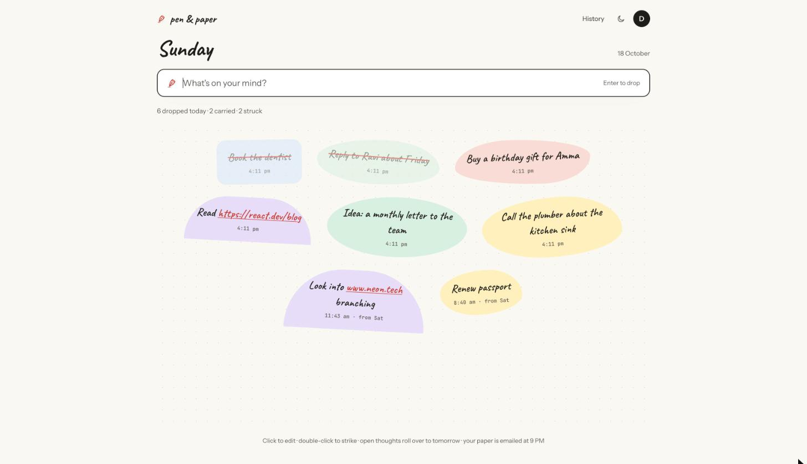
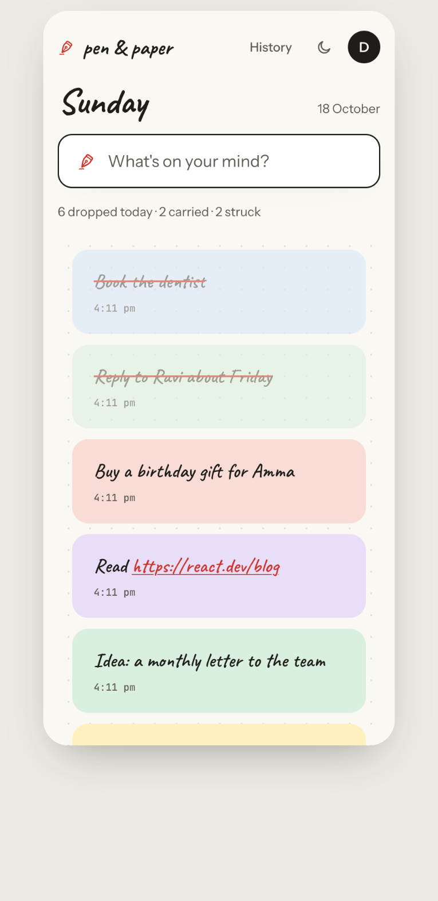
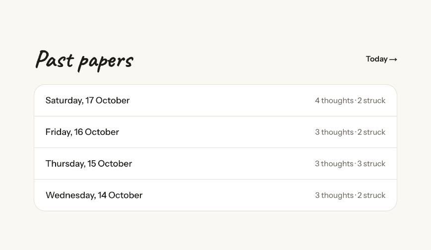
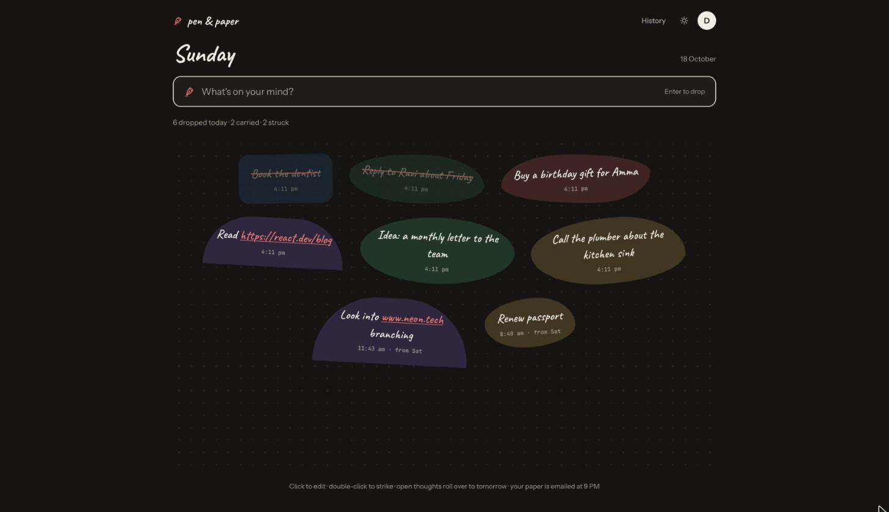

# Pen & Paper

Plan the day, on paper. Live at **https://penandpaper-app.vercel.app**.

Two modules share one app, one sign-in and one database:

| Module | What it does | Where |
| --- | --- | --- |
| **Drop** | A personal brain dump. Open the app, type, press Enter: the thought lands on today's paper. Unstruck thoughts roll over to tomorrow, and a 9 PM email lists the day. | `/drop`, code in `src/modules/drop` |
| **Team** | A lead drops thoughts, estimates them, and drags them onto people. Each person gets their paper at 9:00 in their own time zone. | `/projects`, `/me`, code in `src/screens` |

- [Product Requirements Document](docs/PRD.md) (team planner)

## Drop



| On a phone: a vertical stream | Past papers | Ink (dark) |
| --- | --- | --- |
|  |  |  |

- **Canvas home**: `/drop` opens straight to today's paper with the input focused. Enter drops a thought; it appears instantly (saved in the background) with a soft drop animation.
- **Bubbles**: hand-cut notes, each with its own imperfect outline (seeded by when it was dropped, so it keeps its shape across days) and a faint ink edge, with the time it was dropped shown on hover and a small ↻ on carried ones. Click to edit; double-click (or swipe right on a phone) to strike out: one thin red pen line draws across the words, which stay readable, and a moment later the thought sinks into a **Done today** row of small chips (↺ brings one back); delete from the edit view or the hover buttons. Links are clickable.
- **Daily paper**: each day (in `DROP_TIMEZONE`, default IST) is a fresh paper. Unstruck thoughts from the last paper roll over on the first open of the day, marked "from Sat".
- **9 PM email**: Vercel Cron at 15:30 UTC (21:00 IST) emails today's paper, open ones first and highlighted, done ones struck. No email if nothing was dropped that day.
- **History**: `/drop/history` lists past papers; each opens read-only.
- **Arrange**: new drops land in a row right under the input; arranged thoughts keep their shape below. Drag a thought anywhere on the sheet (it stays within the page column). It snaps like a magnet to a neighbour's centre or edges (a red guide line shows it), otherwise to the dots. The spot is saved and carries over with the thought; new drops land in the free space. **Tidy up** puts everything back into rows.
- **Keyboard first**: Space, or simply typing, puts the cursor in the drop box from anywhere on the page; Enter drops; Esc clears, and a second Esc steps out.
- **Phone**: the canvas becomes a vertical stream with the same input.
- Sign-in required: signed-out visits go to `/signup?next=/drop`.

Shared canvas pieces (bubble looks, the dotted sheet, the interactive thought bubble) live in `src/components/canvas` so the team module can use them too.

## Run it locally

```bash
npm install
cp .env.example .env.local      # then fill in DATABASE_URL, BETTER_AUTH_SECRET, …
npm run db:migrate              # create tables on your database
npm run seed -- you@example.com # optional: a week of Drop papers for that email
npm run dev                     # http://localhost:3000
```

Without Resend configured, development prints every email (sign-in links included) to the terminal, so you can sign in by opening the link from there.

`npm run dev` clears `.next` first: a production build left there breaks the dev server.

Other scripts: `npm test` (unit tests), `npm run lint`, `npm run build`, `npm run db:generate` (after changing a schema), `npm run db:studio`.

## Environment variables

See `.env.example` for the full annotated list.

| Variable | Needed | What for |
| --- | --- | --- |
| `DATABASE_URL` | yes | Neon pooled connection string (the app). |
| `DATABASE_URL_UNPOOLED` | for migrations | Neon direct connection string (`npm run db:migrate`). |
| `BETTER_AUTH_SECRET` | yes | Signs session cookies. One per environment: `openssl rand -base64 32`. |
| `BETTER_AUTH_URL` | production | The site's address, e.g. `https://penandpaper-app.vercel.app`. |
| `RESEND_API_KEY`, `EMAIL_FROM` | for email | Sign-in links, invites, the daily papers. `EMAIL_FROM`'s domain must be verified in Resend. |
| `GOOGLE_CLIENT_ID`, `GOOGLE_CLIENT_SECRET` | optional | "Continue with Google". Redirect URI: `{BETTER_AUTH_URL}/api/auth/callback/google`. |
| `CRON_SECRET` | production | Vercel Cron sends it to `/api/cron/drop-digest`. `openssl rand -hex 24`. |
| `DROP_TIMEZONE` | optional | Drop's day boundaries (default `Asia/Kolkata`). The cron time in `vercel.json` is fixed to 9 PM IST; change both together. |
| `SUPPORT_EMAIL` | optional | Contact address on `/privacy`. |

## Databases

Neon project `penandpaper` (Singapore), one branch per environment:

| Branch | Used by |
| --- | --- |
| `main` | Production |
| `preview` | Vercel Preview deployments |
| `dev` | Local development (`.env.local`) and Vercel Development |

Migrations live in `drizzle/`. Run `npm run db:migrate` against each branch after adding one.

## Deploy

Vercel project `penandpaper`, functions in `sin1` next to the database.

```bash
npx vercel deploy --prod
```

Set the variables above in Vercel → Settings → Environment Variables (Production, Preview, Development) before deploying.

## Code map

```
src/app/                 routes (pages and /api)
src/modules/drop/        Drop: schema, server queries, logic, screens
src/components/canvas/   shared bubbles and paper surface
src/screens/             team planner screens
src/db/                  Drizzle schema (auth + team), repository, connections
src/lib/                 auth, env, time zones, estimates, shared helpers
src/server/              API handling, session, email
scripts/seed.ts          seed data for Drop
```
