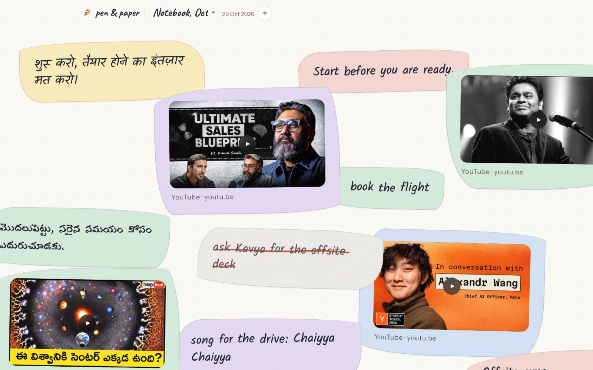
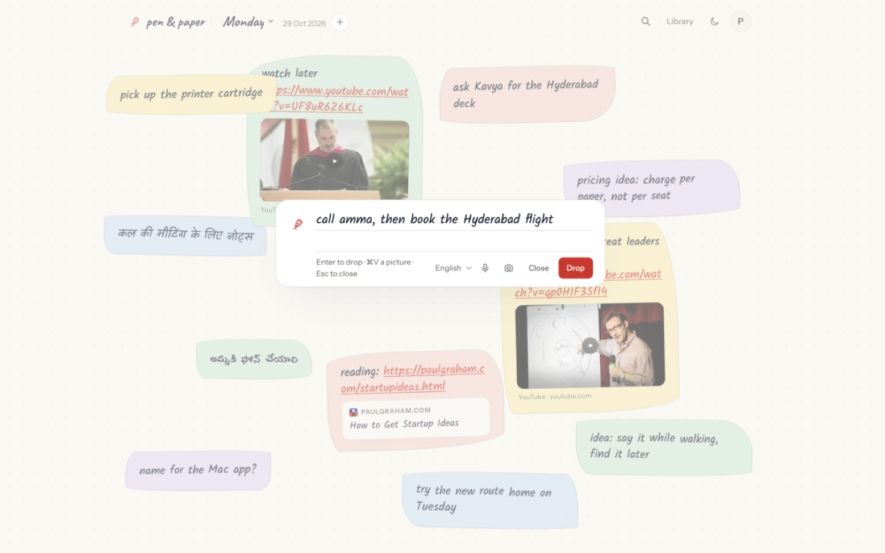
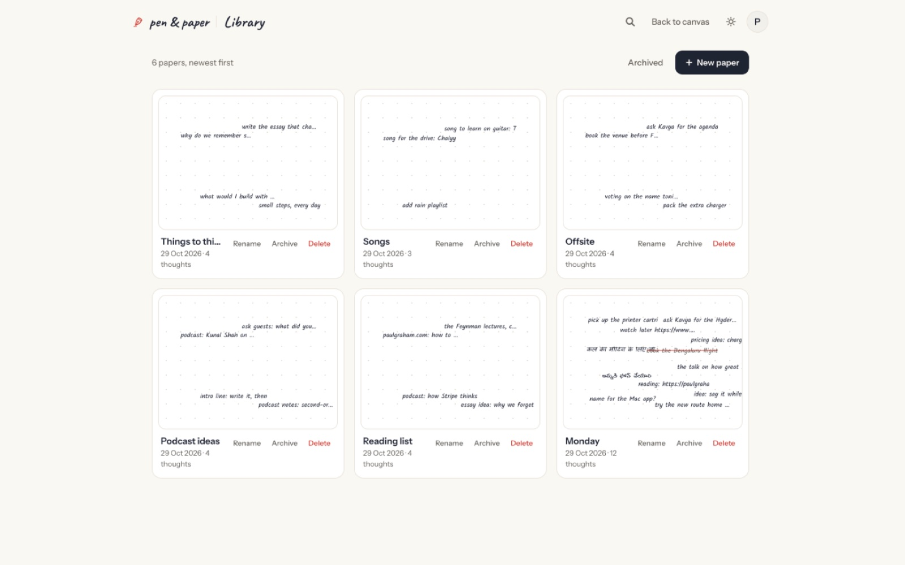
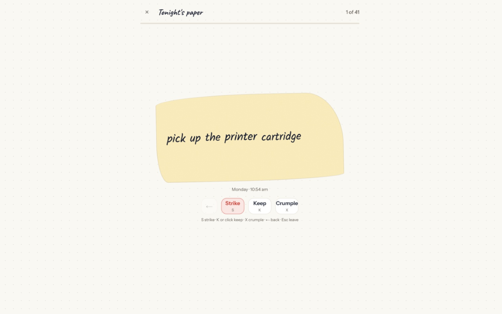
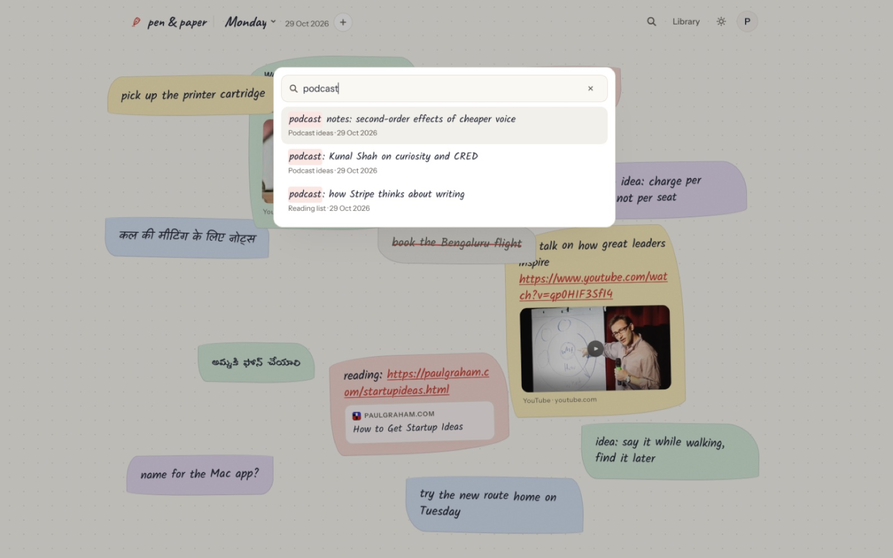
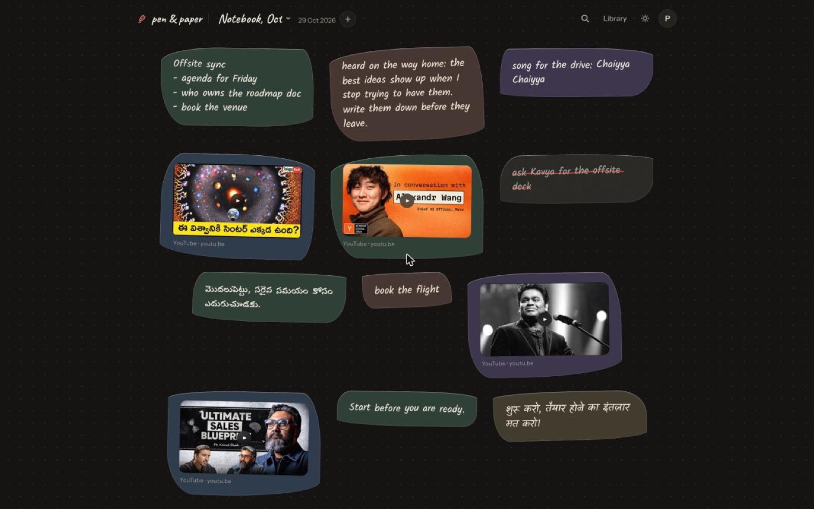
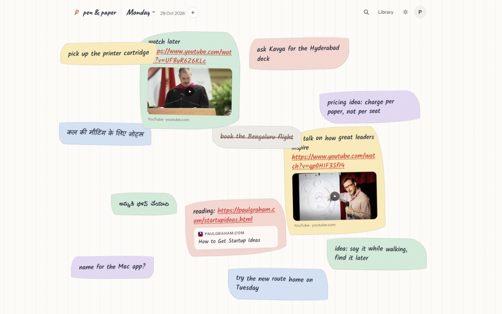

<p align="center">
  <picture>
    <source media="(prefers-color-scheme: dark)" srcset="public/brand/icon-dark.svg" />
    
  </picture>
</p>

<h1 align="center">Pen &amp; Paper</h1>

<p align="center"><b>A calm paper for the thoughts you don't have time to write.</b><br/>
Drop a thought in a second, from the web, Chrome or your Mac. Close the day on paper.</p>

<p align="center">
  <a href="https://penandpaper-app.vercel.app"><b>Live app</b></a> ·
  <a href="#quick-start">Quick start</a> ·
  <a href="docs/GUIDE.md">Full guide</a> ·
  <a href="PRODUCT.md">Product spec</a> ·
  <a href="CONTRIBUTING.md">Contributing</a>
</p>

<p align="center">
  <a href="LICENSE"></a>
  
  
  <a href="CONTRIBUTING.md"></a>
</p>

<p align="center">
  
</p>

Pen & Paper is a place to empty your head. Open a paper, type, press Enter: the thought lands on the page as a hand-drawn note. At night you look back over the day, strike what's done and let go of the rest.

- ✍️ **Drop a thought in a second**: type, paste, speak, or share from any app
- 📄 **Papers you make**: as many as you like, with search across all of them
- 🖍️ **Strike it out**: a red pen line, like on real paper
- 🌙 **Tonight's paper**: a calm review of the day, one card at a time
- 📬 **A 9 PM email** of what you dropped, and old thoughts that come back in the morning
- 🧩 **Capture from anywhere**: a Chrome & Edge extension and a Mac menu-bar app

## Screenshots

| | |
| --- | --- |
|  **Writer**: type and press Enter |  **Library**: every paper at a glance |
|  **Tonight's paper**: strike, keep or crumple |  **Search** every paper |
|  **Dark mode** |  **Dotted, grid or ruled** paper |

---

## Quick start

You need [Node.js 20+](https://nodejs.org) and a free [Neon](https://neon.tech) Postgres database.

```bash
# 1. Get the code
git clone https://github.com/yagnesh-pasam-07/penandpaper.git
cd penandpaper

# 2. Install
npm install

# 3. Add your settings (open .env.local and fill in DATABASE_URL and BETTER_AUTH_SECRET)
cp .env.example .env.local

# 4. Create the database tables
npm run db:migrate

# 5. Start it
npm run dev
```

Open **http://localhost:3000** and sign up. No email service is needed locally: sign-in links are printed in the terminal.

Make a secret for `BETTER_AUTH_SECRET` with `openssl rand -base64 32`. Every other setting is optional and explained in [`.env.example`](.env.example).

### Useful commands

| Command | What it does |
| --- | --- |
| `npm run dev` | Start the app on your computer |
| `npm test` | Run the tests |
| `npm run lint` | Check the code style |
| `npm run build` | Make a production build |
| `npm run seed -- you@example.com` | Add a few sample papers for that email |

## How the project is laid out

```
src/app/             pages and API routes (Next.js)
src/modules/drop/    the paper: notes, papers, search, Tonight's paper
src/components/      shared pieces (notes, the paper surface)
drizzle/             database migrations
extension/           the Chrome & Edge extension
mac/                 the Mac menu-bar app (Swift)
public/brand/        the logo
```

Want the details (every feature, the API, voice, deploying)? Read the **[full guide](docs/GUIDE.md)**.

## Built with

[Next.js](https://nextjs.org) · [React](https://react.dev) · [Tailwind CSS](https://tailwindcss.com) · [Neon Postgres](https://neon.tech) · [Drizzle](https://orm.drizzle.team) · [Better Auth](https://better-auth.com) · hosted on [Vercel](https://vercel.com)

## Contributing

New to open source? You're welcome here.

1. Look for an [issue](https://github.com/yagnesh-pasam-07/penandpaper/issues), or open one to share an idea or a bug.
2. Fork the repo and make a branch.
3. Make your change, then run `npm test` and `npm run lint`.
4. Open a pull request and say what you changed and why.

Read [CONTRIBUTING.md](CONTRIBUTING.md) for more, and please follow the [Code of Conduct](CODE_OF_CONDUCT.md). Found a security problem? See [SECURITY.md](SECURITY.md).

## License

[MIT](LICENSE): free to use, change and share.
