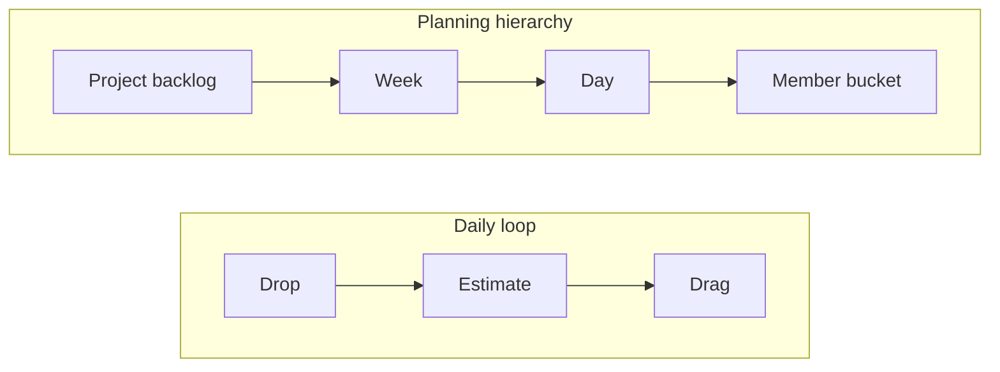

# Pen and Paper — PRD

Oct 18, 2026 · @Yagnesh

## Overview

Pen and Paper is a fast planning board for team leads: drop tasks, estimate them, drag them to people. It brings back the clarity of planning on paper, so every team member starts the day knowing exactly what to build.

- **One line:** Drop → Estimate → Drag.
- **Primary surface:** desktop web app for the team lead.
- **Secondary surface:** member dashboard, later a Chrome extension and Slack Canvas sync.

## Problem & pain points

The lead carries the whole plan in their head every morning, and when it isn't communicated clearly, the team loses the day.

| Pain point | Who feels it | How Pen and Paper solves it |
| --- | --- | --- |
| Morning cognitive overload: deciding who does what, from scratch | Team lead | Dump every thought first, organize later |
| Members unsure what to work on today | Team member | Each person gets a clear daily bucket |
| Overloaded or idle people, no one notices | Lead + member | Estimates add up against a 6h or 8h daily threshold |
| Big goals don't break down into daily work | Team lead | Project → Week → Day hierarchy |
| Jira-style tools are slow and form-heavy for daily planning | Team lead | Canvas-like, keyboard-first, a few seconds per task |
| Plans live in one place, work happens in Slack | Whole team | Push the day's plan to Slack Canvas / member dashboard |

## Target users

- **Team lead (primary):** plans the project, week and day; assigns and estimates work. Uses it every morning on desktop.
- **Team member (secondary):** sees their daily list, adds or adjusts estimates, marks tasks done.
- **Team size:** small product teams, roughly 3–15 people, on any kind of project.

## Goals & success metrics

Success = the lead plans the day in minutes and nobody asks "what should I do today?"

| Goal | Metric | Target (proposed) |
| --- | --- | --- |
| Fast daily planning | Time for lead to plan a day | Under 10 min |
| Low effort per task | Time to drop + estimate one task | Under 10 sec |
| Clear ownership | Members with a planned day by start time | 100% |
| Balanced load | Members within the daily threshold (6h/8h) | 90%+ |
| Habit | Leads planning on 4+ weekdays | 70%+ |

## Core concept

The lead's whole day is three moves, applied at each level of planning.

Tasks flow from the project backlog into a week, then a day, then a member's bucket, which fills up to the daily threshold.

## Features

MVP ships the lead's daily loop; integrations come after the loop feels great.

**MVP (Phase 1)**

1. **Brain-dump inbox** — type a task, hit Enter, next one. No forms.
2. **Inline estimates** — type `2h` or `30m` on the card; lead or member can set it.
3. **Member buckets** — one column per member; drag cards in.
4. **Capacity bar** — per member per day, against a 6h or 8h threshold; turns amber near full, red when over.
5. **Planning hierarchy** — Project backlog → Week → Day → Member.
6. **Milestones** — group project tasks under milestones.
7. **Member dashboard** — "My day": today's tasks, estimates, mark done.
8. **Carry-over** — unfinished tasks roll to tomorrow's inbox.
9. **Keyboard-first** — shortcuts for add, estimate, assign, move day.
10. **Auth + teams** — lead creates a team and invites members.

**Phase 2**

- Slack integration: post each member's day to Slack / Slack Canvas.
- Chrome extension: quick-drop a task from any tab.
- Daily summary: planned vs done hours.

**Phase 3**

- Templates for recurring tasks.
- Estimate accuracy over time per member.
- Multiple projects per lead.

## Design & experience

It should feel like a clean sheet of paper: calm, fast and premium.

| Inspiration | What we borrow |
| --- | --- |
| Excalidraw | Hand-drawn, free canvas feel |
| Google Keep | Light, sticky-note task cards |
| Todo list apps | Instant add, tick-off satisfaction |
| Slack Canvas | Shareable, readable plan for the team |

- **Themes:** white (paper) default, black (ink) dark mode; more themes later.
- **Feel:** generous whitespace, flat paper-like cards, smooth drag animations.
- **Speed:** every core action works from the keyboard; no modal for creating a task.
- **Platform:** desktop-first for the lead; member view responsive for mobile.

## Tech stack

Same stack as Stomach, so the team ships fast on known tools.

| Layer | Choice |
| --- | --- |
| Frontend | Next.js (App Router), Tailwind |
| Backend | Next.js route handlers / server actions |
| ORM | Drizzle ORM (Prisma as fallback) |
| Database | Postgres (e.g. Neon, free tier) |
| Drag and drop | dnd-kit |
| Auth | Auth.js or Clerk |
| Hosting | Vercel |
| Later | Chrome extension (Manifest V3), Slack API |

Fastify is not needed: Next.js handles the backend for MVP.

## Out of scope & open questions

**Not in MVP:** sprints, story points, burndown charts, comments threads, time tracking, mobile app for the lead.

- [ ] Who sets the estimate by default: lead, member, or either?
- [ ] Threshold per team or per member (part-time people)?
- [ ] Slack: post a message, update a Canvas, or both?
- [ ] Chrome extension: quick-add only, or full board in a side panel?
- [ ] Free vs paid plan, and at what team size?
